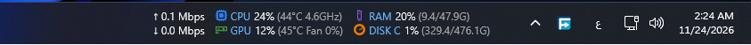
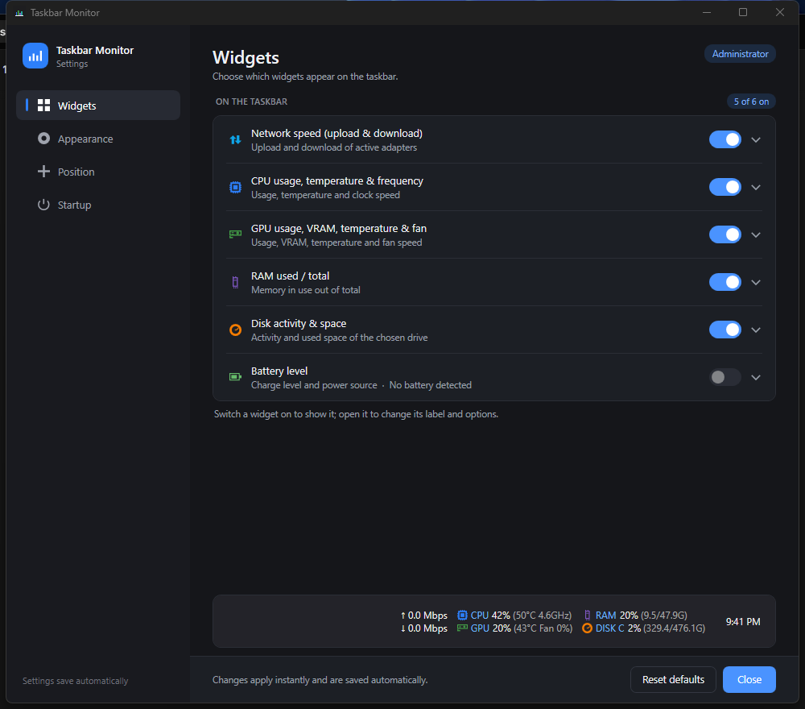
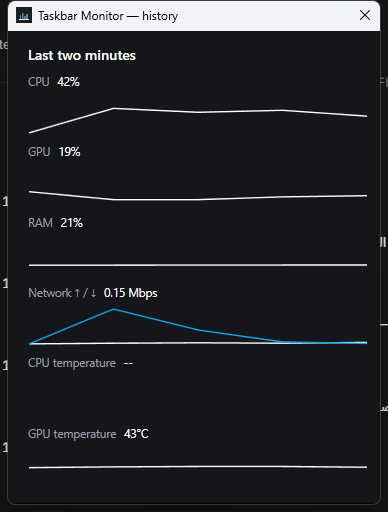

# Taskbar Monitor

Live CPU, GPU, RAM, disk, network and battery readings on the Windows taskbar — a
small transparent strip that sits right next to the tray icons.



<p>
  
  
  
  
  
</p>

No installer, no background service, no telemetry — one self-contained `.exe`
that draws two compact rows over the taskbar and takes up no window space.

## Features

- **Six widgets** in a fixed two-row layout:
  - **Network** (left, both rows) — upload over download for one adapter or all active ones.
  - **CPU** — usage, temperature and clock speed.
  - **GPU** — usage, VRAM, temperature and fan (NVIDIA NVML; Intel and AMD through LibreHardwareMonitor).
  - **RAM** — usage, used / total.
  - **Disk** — activity and used / total space of a chosen drive.
  - **Battery** — charge level and power source (laptops).
- **Per-widget options** — icon, name, used/total, temperature, frequency, VRAM and fan can each be switched on or off.
- **Stable width** — the strip holds its width when digits change, so the readings never shimmy left and right.
- **Warning colors** — values turn amber and red at configurable levels (80 % / 92 % and 85 °C / 95 °C by default).
- **Alerts** — a value that stays above its red level for a minute raises a popup above the taskbar with a sound, then stays quiet until it recovers.
- **History window** — left-click the readings for two minutes of CPU, GPU, RAM, network and temperatures as sparklines.
- **Any position** — every monitor or a chosen one, adjustable gap from the tray, right and vertical offsets.
- **Stays on top** — re-asserts topmost against Windows shell animations, and can optionally stay visible over full-screen apps.
- **Follows the taskbar** — text colors follow the Windows light/dark setting; no panel background.
- **Starts without UAC** — a scheduled task runs it elevated at logon, so CPU temperature works with no prompt.
- **Live settings** — every change applies instantly and saves automatically (250–10 000 ms refresh interval).
- **Updates itself** — the app checks the GitHub release once a day (and shows its own update window on a normal start when one exists); **Check for updates** is also in the taskbar right-click menu and in **Startup → Updates**. One click downloads the new exe into a window with a progress bar, verifies its checksum and restarts into it — no installer, no leftover files.

| Settings | History |
|---|---|
|  |  |

## What it reads

| Reading | Source |
|---|---|
| CPU usage | `GetSystemTimes` deltas |
| CPU temperature, frequency | LibreHardwareMonitor 0.9.6 via the PawnIO driver (needs administrator) |
| RAM used / total | `GlobalMemoryStatusEx` |
| GPU usage, VRAM, temperature, fan | NVIDIA NVML; LibreHardwareMonitor on Intel / AMD |
| Network upload / download | byte counters of the chosen adapter, or of every active adapter |
| Disk activity / space | PDH `LogicalDisk` counter for the chosen drive + `DriveInfo` |
| Battery | `GetSystemPowerStatus` |

GPU readings come from NVIDIA NVML on NVIDIA cards. On Intel and AMD the same
LibreHardwareMonitor library that reads the CPU supplies usage and temperature
(VRAM and fan when the driver exposes them), and the fan is shown in rpm. Without
a supported GPU the GPU widget shows `--`; everything else keeps working. CPU
temperature and frequency additionally need the app to run
as administrator **and the [PawnIO](https://github.com/namazso/PawnIO.Setup/releases)
driver installed** — LibreHardwareMonitor reads the chipset through PawnIO
instead of the WinRing0 driver that Microsoft now blocks. Without either, those
two values are simply omitted.

## Download and run

Download the latest portable build from the [Releases page](https://github.com/AnwerAbdelkadir/Taskbar-Monitor/releases),
or build it yourself (see [Build](#build)). Copy `TaskbarMonitor.exe` anywhere and
run it — there is nothing to install.

```
TaskbarMonitor.exe             start with the settings window
TaskbarMonitor.exe --silent    start the overlay only
TaskbarMonitor.exe --replace   take over from a running copy
```

- **Left-click** the readings to open the history window.
- **Right-click** them for settings, pause, Windows startup, **Check for updates** and exit.
- Running the exe again while it is running opens the settings window (single instance).
- Settings and the log live in `%AppData%\TaskbarMonitor`.

## Settings

- **Widgets** — enable/disable every reading and toggle its chips (icon, name,
  used/total, temperature, frequency, VRAM, fan). The **Disk** widget has a
  **Drive** picker (activity and space follow that partition); the **Network**
  widget has an **Adapter** picker (the default measures every active adapter, or
  pick a VPN / virtual NIC to watch just that one). CPU temperature and
  frequency start off; their switches stay locked (dimmed, click does nothing but
  reveal a short hint) until the app runs as administrator and PawnIO is
  installed. The hint offers **Restart as administrator** and **Install the
  PawnIO driver** (downloads the official setup and runs it elevated), and the
  reading only turns on when the user flips the switch after that.
- **Appearance** — settings-window theme (auto / light / dark), font and size,
  spacing, network unit (Mbps or MB/s) and the refresh interval.
- **Position** — all monitors or one, gap from the tray, offset from the right
  edge, vertical offset and Reset. Values can be typed as well as dragged; the
  strip is clamped inside the taskbar so it never covers the tray. **Show over
  full-screen apps** is off by default.
- **Startup** — start with Windows, optionally elevated through a scheduled task
  (no UAC prompt at logon), and the **Updates** row: current version, **Check now**
  and **Download and install** when a newer release exists.
- **Warnings** — the amber and red levels for percentages and temperatures.
- **Alerts** — enable or disable the critical popup.

## Build

Requires the [.NET 8 SDK](https://dotnet.microsoft.com/download/dotnet/8.0).

```
dotnet publish TaskbarMonitor/TaskbarMonitor.csproj -c Release -r win-x64 \
  --self-contained true -p:PublishSingleFile=true \
  -p:IncludeNativeLibrariesForSelfExtract=true -p:DebugType=None \
  -p:DebugSymbols=false -o dist
```

The output folder is portable: copy `dist/` anywhere and run
`dist/TaskbarMonitor.exe`. For a quick debug build and run:

```
dotnet build TaskbarMonitor/TaskbarMonitor.csproj -c Debug
TaskbarMonitor/bin/Debug/net8.0-windows/TaskbarMonitor.exe
```

## Troubleshooting

- **CPU temperature / frequency missing** — the app must run as administrator
  *and* PawnIO must be installed once: open the CPU widget in **Widgets** and
  press **Install the PawnIO driver**, or run `PawnIO_setup.exe -install` elevated
  yourself
  (from the [PawnIO releases](https://github.com/namazso/PawnIO.Setup/releases)).
  `/S` does not work — it exits with code 87 and installs nothing.
- **GPU shows `--` on Intel or AMD** — those GPUs read through LibreHardwareMonitor
  and need the same PawnIO driver; the GPU widget row offers the same button.
- **GPU shows `--`** — the card is not visible to NVML or LibreHardwareMonitor
  (very old drivers, a virtual machine, or a GPU running in a passthrough setup).
  Everything else keeps working.
- **Readings hidden behind the taskbar** — the strip re-asserts topmost every
  25 ms to survive shell animations; the shell briefly covers it on the primary
  monitor during minimize/restore animations, and it recovers by itself.
- **Settings do not stick** — `%AppData%\TaskbarMonitor\settings.json` is only
  safe to edit while the app is closed; the app saves its in-memory copy on exit.
- **Battery widget disabled** — desktops report no battery; the switch is locked.

## Notes and limits

- The overlay is a transparent topmost window positioned over the real taskbar
  (`Shell_TrayWnd` / `Shell_SecondaryTrayWnd`), not a taskbar toolbar — that is
  what keeps it working on the Windows 11 XAML taskbar. On Windows 11 the tray is
  measured through UI Automation because `TrayNotifyWnd` is empty there.
- The strip hides while the taskbar is auto-hidden and follows taskbar moves and
  DPI changes. It is drawn in physical pixels, so per-monitor DPI is respected.
- Vertical taskbars get a floating block beside the taskbar rather than a rotated
  layout.
- x64 only. Windows 10 and Windows 11.
- No driver file is written next to the exe; PawnIO is installed once by its own
  setup.
